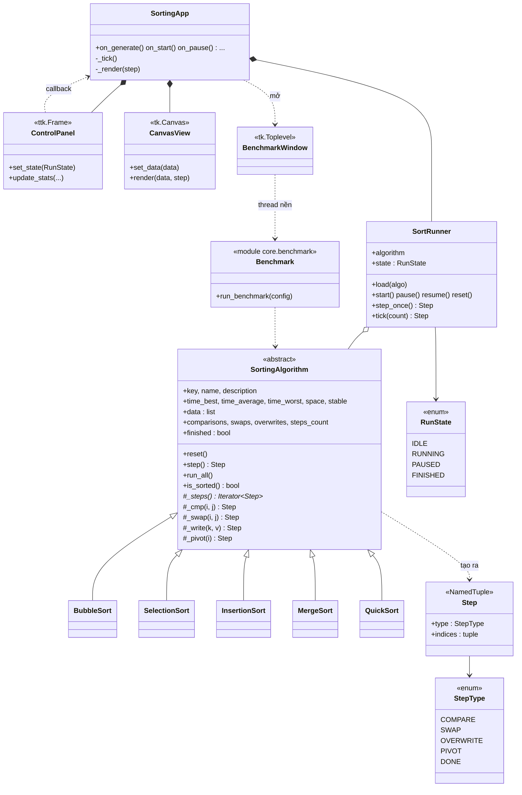
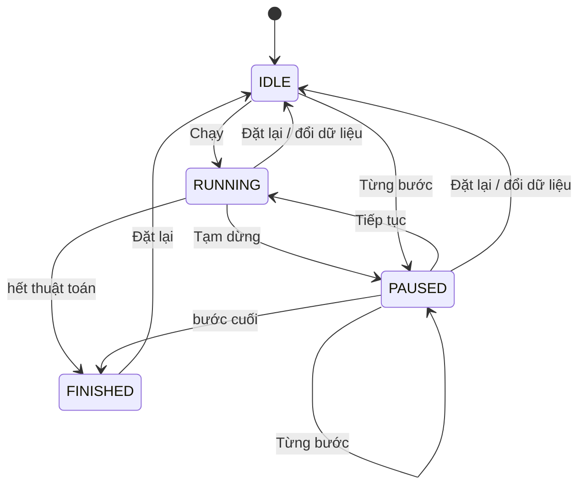

# BÁO CÁO ĐỀ TÀI 28: HỆ THỐNG TRỰC QUAN HÓA THUẬT TOÁN SẮP XẾP

## 1. Giới thiệu và phân tích yêu cầu

**Mục tiêu:** minh họa quá trình thực hiện các thuật toán sắp xếp trên Canvas, cho phép quan sát từng bước
và so sánh hiệu năng giữa các thuật toán.

**Dữ liệu chính:** dãy số, thuật toán, bước thực hiện, cấu hình tốc độ, kết quả.

### 1.1 Đối chiếu yêu cầu của đề với hiện thực

| Yêu cầu của đề | Hiện thực | Vị trí |
|---|---|---|
| Sinh hoặc nhập dãy số | Sinh theo 5 kịch bản; nhập tay; nạp/lưu JSON/CSV | `core/data_manager.py`, `ui/control_panel.py` |
| ≥ 3 thuật toán | **5** thuật toán: Bubble, Selection, Insertion, Merge, Quick | `algorithms/` |
| Chạy từng bước, tạm dừng, tiếp tục | Nút Chạy / Tạm dừng / Tiếp tục / Từng bước / Đặt lại; máy trạng thái 4 trạng thái | `core/runner.py`, `ui/app.py` |
| Đếm số so sánh và hoán đổi | Bộ đếm `comparisons`, `swaps` (và `overwrites` cho Merge Sort), hiển thị thời gian thực | `algorithms/base.py` |
| So sánh hiệu năng nhiều kích thước | Module benchmark + cửa sổ bảng/biểu đồ, 5 kịch bản dữ liệu | `core/benchmark.py`, `ui/benchmark_window.py` |
| Canvas cột dữ liệu | `CanvasView` vẽ cột, tô màu theo thao tác | `ui/canvas_view.py` |
| Slider tốc độ | `ttk.Scale` 1–100, đổi tốc độ ngay khi đang chạy | `ui/control_panel.py` |
| Custom ControlPanel | `ControlPanel(ttk.Frame)` tự xây dựng, giao tiếp bằng callback | `ui/control_panel.py` |
| Lớp trừu tượng `SortingAlgorithm` | `SortingAlgorithm(ABC)` với phương thức trừu tượng `_steps()` | `algorithms/base.py` |
| Đa hình `step()` | Mỗi thuật toán cài `_steps()` (generator); `step()` ở lớp cha dùng chung | `algorithms/*.py` |
| Lưu kết quả kiểm thử | Benchmark tự lưu `data/results/benchmark_*.json`, xuất thêm CSV | `core/data_manager.py` |
| Dữ liệu JSON/CSV mẫu | `data/sample.json`, `sample.csv`, `sample_nearly_sorted.json`, kết quả mẫu | `data/` |
| Báo cáo, thiết kế lớp, kiểm thử, hướng dẫn | Tài liệu này và `HuongDanSuDung.md` | `docs/` |

## 2. Thiết kế

### 2.1 Nguyên tắc: tách logic khỏi giao diện

Ba tầng độc lập, phụ thuộc một chiều `ui → core → algorithms`:

* **algorithms/** – thuật toán thuần, không biết Tkinter.
* **core/** – dữ liệu, máy trạng thái, benchmark; cũng không import Tkinter.
* **ui/** – chỉ lo hiển thị và nhận thao tác.

Nhờ vậy toàn bộ logic kiểm thử và benchmark được chạy không cần cửa sổ (kể cả bằng dòng lệnh).

### 2.2 Sơ đồ lớp

### 2.3 Đa hình `step()` bằng generator

Mỗi thuật toán cài đặt generator `_steps()`; mỗi lần `yield` là một thao tác nguyên tử (so sánh, hoán đổi, ghi
đè, đánh dấu chốt). Lớp cha `SortingAlgorithm.step()` gọi `next()` trên generator và trả về `Step` kế tiếp
(hoặc `DONE` đúng một lần khi kết thúc). Cách này:

* tránh phải tự lưu trạng thái các vòng lặp lồng nhau (kể cả đệ quy của Merge Sort bằng `yield from`);
* cho phép giao diện, kiểm thử và benchmark dùng chung *một* cài đặt thuật toán;
* các hàm trợ giúp `_cmp/_swap/_write` vừa thực hiện thao tác, vừa tăng bộ đếm, vừa tạo `Step` nên số liệu
  thống kê luôn khớp với số bước thực sự xảy ra (có test kiểm tra điều này).

### 2.4 Máy trạng thái chạy

Các chuyển trạng thái không hợp lệ (ví dụ "Chạy" khi đang chạy) bị từ chối ở `SortRunner`, vì vậy không bao giờ
có hai vòng lặp hoạt hình chạy chồng nhau.

### 2.5 Vòng lặp hoạt hình

Dùng `root.after(delay, _tick)`, **không dùng `time.sleep`** nên cửa sổ luôn phản hồi. Mỗi tick:
`runner.tick(n)` chạy `n` bước → `CanvasView.render` → cập nhật thống kê → tự đặt lịch tick sau nếu vẫn RUNNING.
Slider được đổi thành cặp (độ trễ, số bước/tick) bởi `speed_to_timing`: tốc độ 1 → 1000 ms × 1 bước; tốc độ 100
→ 10 ms × 10 bước (≈1000 bước/giây). Khi Tạm dừng/Đặt lại/Đổi dữ liệu, `after_id` cũ luôn được huỷ.

### 2.6 Canvas và bảng điều khiển cuộn được

`CanvasView` tạo các hình chữ nhật **một lần** rồi chỉ `coords/itemconfig` những cột thực sự thay đổi, nhờ đó vẫn
mượt với vài trăm cột. Thang chiều cao được cố định theo min/max của dãy ban đầu (tránh giật hình khi Merge Sort
ghi đè tạm thời); hỗ trợ số âm và dãy toàn bằng nhau. Dưới 40 cột sẽ hiện thêm giá trị trên đầu cột.

`ControlPanel` tự bọc nội dung trong `Canvas + Scrollbar`, nên khi cửa sổ thấp hơn nội dung (màn hình nhỏ) vẫn kéo thanh cuộn hoặc lăn chuột để tới các mục phía dưới (Thống kê, So sánh hiệu năng). Sự kiện lăn chuột chỉ được bắt khi con trỏ nằm trên bảng.

### 2.7 Benchmark

Với mỗi (kịch bản, kích thước) các thuật toán sắp xếp **cùng** các bộ dữ liệu (cố định seed → lặp lại được);
kết quả là trung bình của N lần lặp. Cửa sổ benchmark chạy ở luồng nền, truyền kết quả về giao diện qua
`queue.Queue` (luồng nền không bao giờ thao tác trực tiếp lên widget).

### 2.8 Định dạng dữ liệu

* Dãy số: JSON `{"size": n, "data": [...]}` (hoặc mảng thuần) / CSV một cột `value`.
* Kết quả: JSON `{"generated_at": ..., "results": [...]}` / CSV với các cột
  `algorithm, scenario, size, repeats, comparisons, swaps, overwrites, steps, time_ms, correct`.

## 3. Các thuật toán đã cài đặt

| Thuật toán | Tốt nhất | Trung bình | Xấu nhất | Bộ nhớ phụ | Ổn định | Ghi chú cài đặt |
|---|---|---|---|---|---|---|
| Bubble Sort | O(n) | O(n²) | O(n²) | O(1) | Có | Có cờ dừng sớm |
| Selection Sort | O(n²) | O(n²) | O(n²) | O(1) | Không | ≤ n−1 hoán đổi |
| Insertion Sort | O(n) | O(n²) | O(n²) | O(1) | Có | Dạng hoán đổi liền kề |
| Merge Sort | O(n log n) | O(n log n) | O(n log n) | O(n) | Có | Dùng *ghi đè* thay hoán đổi |
| Quick Sort | O(n log n) | O(n log n) | O(n²) | O(log n) | Không | Chốt cuối, ngăn xếp tường minh (không giới hạn đệ quy) |

## 4. Kiểm thử

### 4.1 Tổng quan

Chạy bằng `python -m unittest discover -s tests -t .` – **85 test, tất cả đạt**.

| Tệp test | Số test | Nội dung chính |
|---|---|---|
| `test_algorithms.py` | 19 | Đúng đắn của 5 thuật toán trên 9 loại dãy (rỗng, 1 phần tử, trùng lặp, đã sắp xếp, đảo ngược, số âm, ngẫu nhiên…) + fuzz 300 dãy ngẫu nhiên; chạy từng bước ≡ chạy một mạch; `DONE` chỉ phát một lần; chỉ số bước hợp lệ; `reset`; không sửa dữ liệu đầu vào; Quick Sort không lỗi đệ quy với 1500 phần tử đã sắp xếp; kiểm tra bộ đếm |
| `test_data_manager.py` | 14 | Sinh dữ liệu (seed, 5 kịch bản, tham số sai); phân tích chuỗi nhập (nhiều dấu phân cách, lỗi); đọc/ghi JSON/CSV khứ hồi; file hỏng/rỗng/sai đuôi; tạo thư mục thiếu; file mẫu đi kèm đọc được |
| `test_runner_benchmark.py` | 16 | Ánh xạ tốc độ; mọi chuyển trạng thái hợp lệ/không hợp lệ; bước tay; tạm dừng–tiếp tục cho cùng kết quả; đặt lại; dãy rỗng/1 phần tử; benchmark (đúng đắn, tái lập theo seed, callback, huỷ, cấu hình sai, lưu file) |
| `test_ui_headless.py` | 36 | Logic giao diện với `tkinter` giả: luồng Chạy/Tạm dừng/Tiếp tục/Từng bước/Đặt lại cho cả 5 thuật toán, không tạo vòng lặp chồng, tô màu cột, thống kê, nhập/nạp/lưu file và báo lỗi, cửa sổ benchmark (bảng, biểu đồ, tự lưu, dừng, đóng cửa sổ), bảng điều khiển cuộn được (thanh cuộn, lăn chuột Windows/macOS/Linux) |

### 4.2 Các tính chất toán học được kiểm chứng bằng test

* Bubble/Insertion trên dãy đã sắp xếp: đúng **n−1** lần so sánh, **0** hoán đổi.
* Bubble/Insertion trên dãy đảo ngược (không trùng): số hoán đổi = **n(n−1)/2** (số nghịch thế).
* Selection Sort: luôn đúng **n(n−1)/2** lần so sánh và **≤ n−1** hoán đổi.
* Merge Sort: **0** hoán đổi, số so sánh ≤ n·log₂n.
* Khi n tăng 4 lần, so sánh của Bubble tăng > 12 lần (≈ n²), của Merge < 6 lần (≈ n log n).
* Bộ đếm luôn bằng số `Step` cùng loại thực sự được phát ra.

### 4.3 Kiểm thử thủ công giao diện (checklist)

Bộ test giao diện dùng `tkinter` giả nên kiểm tra *logic* chứ không kiểm tra hiển thị thật. Danh sách sau dùng
để xác nhận trên màn hình thật (đánh dấu ✔ khi đạt):

| # | Thao tác | Kết quả mong đợi | Kết quả |
|---|---|---|---|
| 1 | `python main.py` | Cửa sổ hiện 30 cột, trạng thái "Sẵn sàng" | ☐ |
| 2 | Bấm Chạy với từng thuật toán | Cột đổi màu vàng/đỏ, kết thúc toàn xanh lá, trạng thái "Hoàn thành" | ☐ |
| 3 | Bấm Tạm dừng rồi Từng bước vài lần, rồi Tiếp tục | Dừng ngay, mỗi lần bấm đúng 1 bước, tiếp tục đúng chỗ | ☐ |
| 4 | Kéo slider trong lúc chạy | Tốc độ đổi ngay | ☐ |
| 5 | Sinh 300 phần tử, chạy tốc độ cao | Mượt, không đơ cửa sổ | ☐ |
| 6 | Nhập `9 4 7 1 8`, `abc`, ô trống | Dãy hợp lệ được nhận; hai trường hợp sau báo lỗi | ☐ |
| 7 | Nạp `data/sample.json`, `sample.csv`; lưu dãy ra file mới | Hiển thị đúng; file lưu đọc lại được | ☐ |
| 8 | Co giãn cửa sổ; thu thấp cửa sổ rồi lăn chuột/kéo thanh cuộn trên bảng điều khiển | Cột vẽ lại đúng tỉ lệ, giữ nguyên màu; cuộn tới được mục Thống kê và nút So sánh hiệu năng | ☐ |
| 9 | Mở So sánh hiệu năng, chạy `100,500,1000` | Thanh tiến trình chạy, cửa sổ không đơ, bảng đầy đủ, biểu đồ vẽ, file JSON xuất hiện trong `data/results/` | ☐ |
| 10 | Đóng cửa sổ benchmark khi đang chạy; đóng cửa sổ chính | Không báo lỗi, chương trình thoát hẳn | ☐ |

## 5. Kết quả so sánh hiệu năng

Đo bằng `python main.py --benchmark --sizes 100,500,1000,2000 --scenario all --repeats 3`
(toàn bộ 100 phép đo, **100% sắp xếp đúng**; tệp gốc: `data/results/benchmark_report.json` / `.csv`).
Số lần so sánh/hoán đổi là trung bình của 3 lần lặp, chính xác và không phụ thuộc máy; thời gian phụ thuộc máy.

### 5.1 Dãy ngẫu nhiên, n = 2000

| Thuật toán | So sánh | Hoán đổi | Ghi đè | Thời gian (ms) |
|---|---:|---:|---:|---:|
| Bubble Sort | 1 998 661 | 1 007 794 | – | 1 582 |
| Selection Sort | 1 999 000 | 1 993 | – | 1 118 |
| Insertion Sort | 1 009 786 | 1 007 794 | – | 1 107 |
| Merge Sort | 19 423 | – | 21 952 | 28.7 |
| Quick Sort | 25 359 | 12 687 | – | 27.8 |

### 5.2 Ảnh hưởng của dạng dữ liệu, n = 2000 (số lần so sánh / thời gian ms)

| Thuật toán | Ngẫu nhiên | Đã sắp xếp | Đảo ngược |
|---|---:|---:|---:|
| Bubble Sort | 1 998 661 / 1 582 | **1 999 / 0.9** | 1 999 000 / 2 328 |
| Selection Sort | 1 999 000 / 1 118 | 1 999 000 / 1 154 | 1 999 000 / 1 230 |
| Insertion Sort | 1 009 786 / 1 107 | **1 999 / 1.0** | 1 998 997 / 2 205 |
| Merge Sort | 19 423 / 28.7 | 11 088 / 21.1 | 10 919 / 38.7 |
| Quick Sort | 25 359 / 27.8 | **1 897 757 / 1 039** | 1 947 622 / 1 082 |

### 5.3 Tốc độ tăng theo kích thước (dãy ngẫu nhiên, thời gian ms)

| n | Bubble | Selection | Insertion | Merge | Quick |
|---:|---:|---:|---:|---:|---:|
| 100 | 3.3 | 2.2 | 2.3 | 0.8 | 0.6 |
| 500 | 110 | 64 | 61 | 5.3 | 3.8 |
| 1000 | 376 | 237 | 319 | 11.5 | 8.1 |
| 2000 | 1 582 | 1 118 | 1 107 | 28.7 | 27.8 |

### 5.4 Nhận xét

1. **O(n²) so với O(n log n):** khi n tăng gấp đôi (1000 → 2000), số so sánh của Bubble tăng ≈ 4,0 lần còn
   Merge chỉ ≈ 2,2 lần. Ở n = 2000, Merge/Quick nhanh hơn các thuật toán O(n²) khoảng **39–57 lần**.
2. **Dãy đã sắp xếp** là trường hợp tốt nhất của Bubble (dừng sớm) và Insertion: chỉ n−1 = 1999 phép so sánh.
   Ngược lại Selection Sort *không hưởng lợi* gì: luôn n(n−1)/2 phép so sánh.
3. **Trường hợp xấu của Quick Sort:** với chốt là phần tử cuối, dãy đã sắp xếp/đảo ngược làm số so sánh nhảy
   từ ~25 nghìn lên ~1,9 triệu (tăng ≈ 75 lần), tương đương O(n²). Biện pháp khắc phục: chọn chốt ngẫu nhiên hoặc
   median-of-three.
4. **Số hoán đổi:** Selection Sort chỉ cần ≈ n hoán đổi (1 993) trong khi Bubble/Insertion cần ≈ n²/4 (1 007 794) –
   có ý nghĩa khi chi phí ghi dữ liệu cao.
5. **Merge Sort** không hoán đổi mà *ghi đè* (≈ n log n lần) và cần O(n) bộ nhớ phụ; đổi lại hiệu năng ổn định
   ở mọi dạng dữ liệu.
6. Insertion Sort trên dãy *gần như sắp xếp* nhanh hơn rõ rệt so với Bubble/Selection (xem
   `benchmark_report.json`, kịch bản `nearly_sorted`).

### 5.5 Giới hạn của phép đo

Thời gian đo quanh `run_all()` nên gồm cả chi phí sinh đối tượng `Step` cho hoạt hình (như nhau với mọi thuật
toán, nên tỉ lệ giữa các thuật toán vẫn có ý nghĩa nhưng thời gian tuyệt đối lớn hơn bản cài đặt "thuần"). Số
liệu ms thay đổi theo máy và tải hệ thống; để kết luận chắc chắn nên tăng số lần lặp.

## 6. Hạn chế và hướng phát triển

* Hoạt hình giới hạn 500 cột (benchmark tới 5000 phần tử); với dãy lớn hơn cần vẽ theo lô/đa luồng.
* Có thể bổ sung Heap Sort, Shell Sort; chọn chốt ngẫu nhiên cho Quick Sort; hiển thị song song hai thuật toán.
* Thêm âm thanh theo giá trị cột, xuất ảnh/GIF quá trình chạy, lưu và phát lại lịch sử bước.
* Thêm bước lùi (undo) bằng cách lưu lịch sử trạng thái.

## 7. Kết luận

Hệ thống đáp ứng đầy đủ các chức năng bắt buộc và phần nâng cao của đề: giao diện Tkinter với Canvas, slider
tốc độ và ControlPanel tự xây dựng; 5 thuật toán qua lớp trừu tượng `SortingAlgorithm` với `step()` đa hình;
chạy từng bước/tạm dừng/tiếp tục; thống kê so sánh–hoán đổi; benchmark nhiều kích thước có lưu kết quả JSON/CSV;
85 test tự động. Việc tách logic khỏi giao diện là quyết định thiết kế quan trọng nhất: nó cho phép kiểm thử
toàn bộ thuật toán, máy trạng thái và benchmark mà không cần cửa sổ, và dễ mở rộng thêm thuật toán mới
(chỉ cần một lớp con cài `_steps()` và thêm vào danh sách đăng ký).
